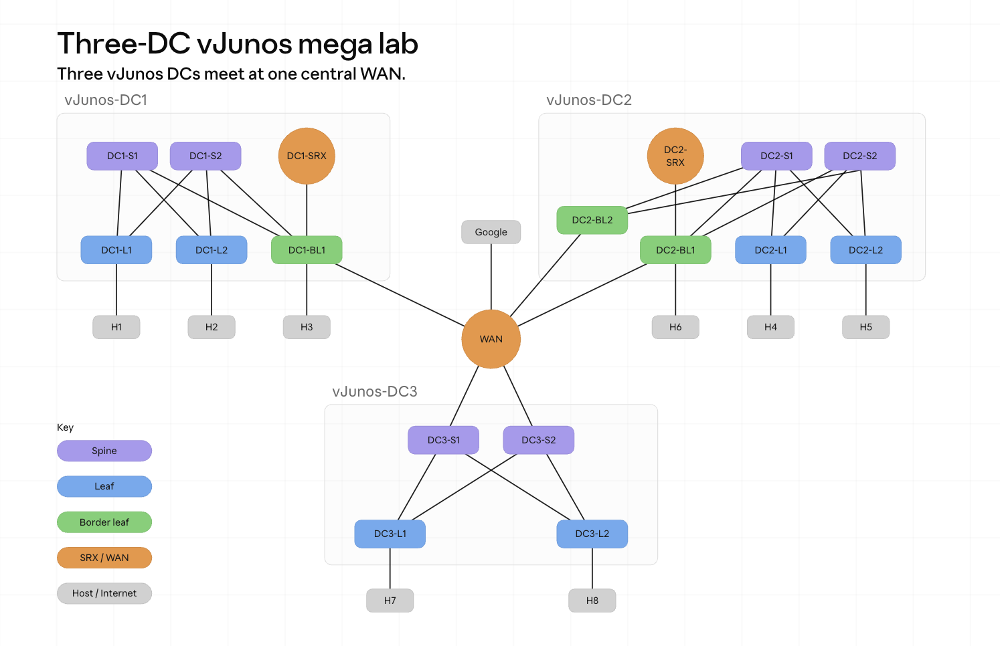

# Three-DC vJunos EVPN-VXLAN lab

A self-built, three-datacenter EVPN-VXLAN lab for JNCIE-DC preparation. Three vJunos DCs meet at one central WAN, with inter-DC EVPN signaling, inter-tenant firewalling, and Internet access built several different ways so each design can be compared side by side.

Device configurations are in this repository.

## Contents

- [Platform](#platform)
- [Tenants, VLANs and addressing](#tenants-vlans-and-addressing)
- [Routing design](#routing-design)
- [Data center interconnect](#data-center-interconnect)
- [Inter-tenant traffic](#inter-tenant-traffic)
- [Internet access](#internet-access)

## Platform

- **Each POD is one vJunos-switch image.** The spines and leaves inside a POD are separate `logical-systems`, stitched together with `logical-tunnel` (`lt-`) interfaces, so a whole fabric runs from a single VM.
- **The vMX is the central WAN.** It is the hub for Internet access ("Google" in the diagram).
- **DC1 and DC2 each have an SRX** for inter-tenant policy and Internet breakout.

| DC | Nodes |
|---|---|
| DC1 | DC1-S1, DC1-S2, DC1-L1, DC1-L2, DC1-BL1, DC1-SRX |
| DC2 | DC2-S1, DC2-S2, DC2-L1, DC2-L2, DC2-BL1, DC2-BL2, DC2-SRX |
| DC3 | DC3-S1, DC3-S2, DC3-L1, DC3-L2 |

## Tenants, VLANs and addressing

| Tenant | VLAN | Subnet |
|---|---|---|
| tenant1 | 100 | 192.168.100.0/24 |
| tenant1 | 101 | 192.168.101.0/24 |
| tenant2 | 102 | 192.168.102.0/24 |

DC1 and DC2 both carry tenant1 and tenant2. VLAN 100 is also stretched between DC2 and DC3 (see [Data center interconnect](#data-center-interconnect)). Each tenant is an IP VRF. Tenants communicate with each other only through a firewall (DC1 and DC2) or through route leaking (DC3), described below.

## Routing design

| | Underlay and overlay |
|---|---|
| DC1 | EBGP |
| DC2 | EBGP |
| DC3 | IBGP overlay, with the spines as route reflectors |

## Data center interconnect

- **DC2 is the hub.** DC2 acts as the hub for traffic between DC1 and DC3, using an over-the-top (OTT) EVPN gateway design for the EVPN signaling. Next hops are preserved on the border leaves (`no-nexthop-change`), so a leaf in one DC tunnels straight to a leaf in another.
- **DC2 to DC3 stitching.** DC2 and DC3 use DCI to stitch VLAN 100 together across the PODs, so the same Layer 2 domain spans both.

## Inter-tenant traffic

### DC1 and DC2: SRX steering with a primary and a backup

DC2-SRX is the backhaul for all inter-tenant traffic between DC1 and DC2. DC1-SRX is the failover firewall.

- The border leaves in DC2 advertise the tenant /24s `orlonger` to DC2-SRX, so the host /32s are included. DC1's border leaf advertises only the /24s to DC1-SRX.
- A /32 beats a /24 before AS path is compared, so every leaf in both DCs prefers the /32 routes that come through DC2-SRX. Both directions of a flow cross the same stateful firewall.
- If DC2-SRX fails, its /32s withdraw and both directions move to DC1-SRX together.
- The SRXs export only the other tenant's routes to each border leaf. This keeps same-tenant routes from being reflected back and prevents leaks between the border leaves.

Without this steering, each leaf prefers its nearest border leaf, the two directions use different SRXs, and each firewall sees half of the session, which drops TCP.

### DC3: RIB groups and route leaking

DC3 has no firewall. Inter-tenant traffic is handled with RIB groups and auto-export EVPN route leaking, using a shared VRF target community.

## Internet access

- **DC1 and DC2.** Tenant traffic hairpins through the local SRX. The border leaf runs a native untagged BGP session in `inet.0` to the SRX, and the WAN is reached from there.
- **DC3.** Uses selective EVPN host-route leaking from the tenant VRF into `inet.0` to reach the Internet. AS-path filtering and a SPINE-to-LEAF community filter prevent routing loops and traffic tromboning.
- **WAN.** The vMX is the central hub that all three DCs reach for Internet access.
